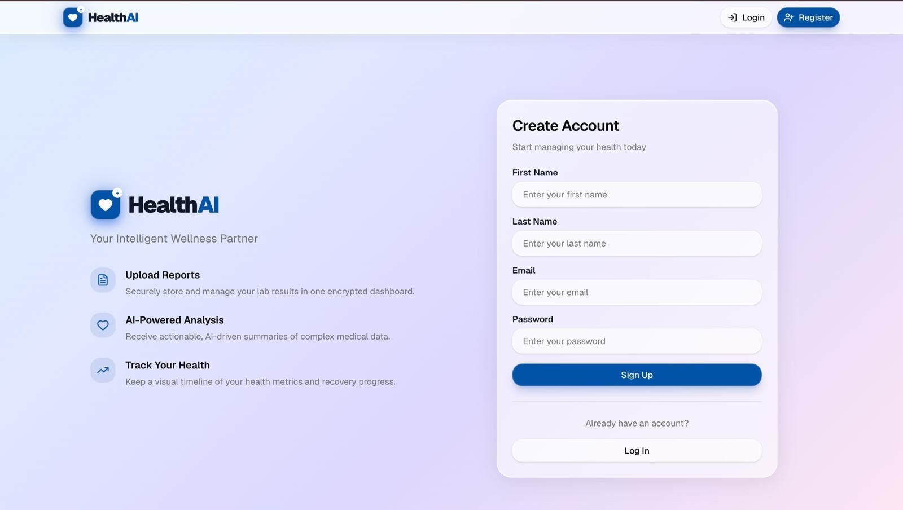
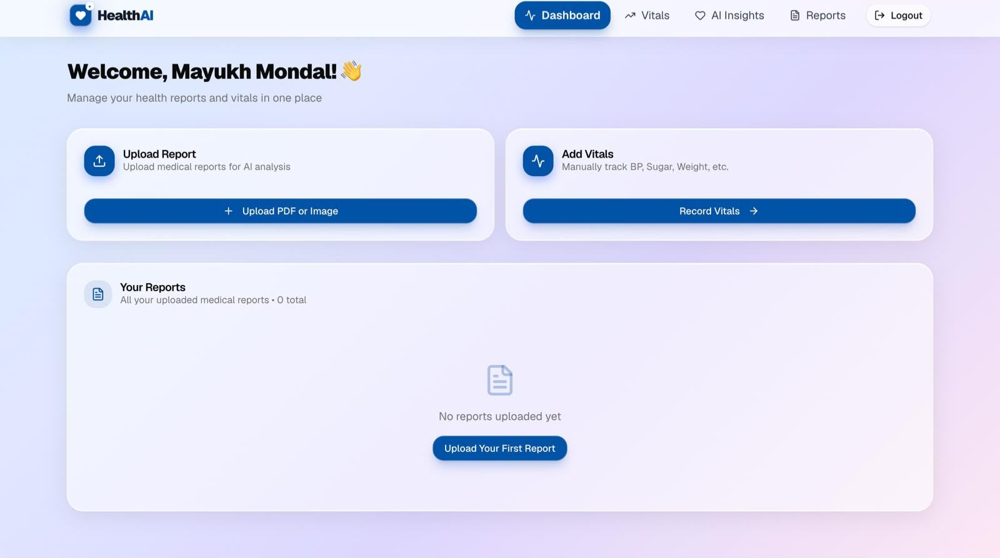
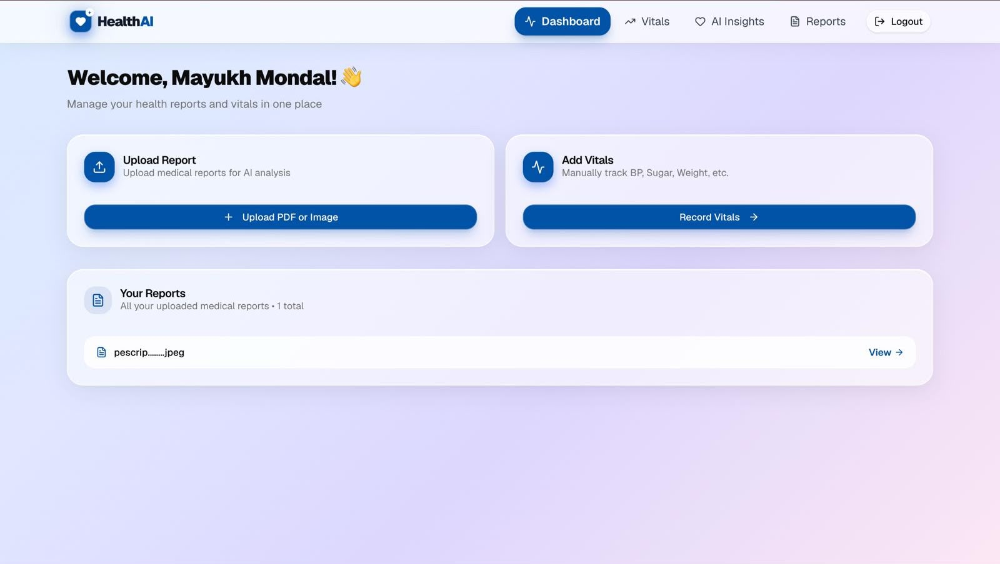
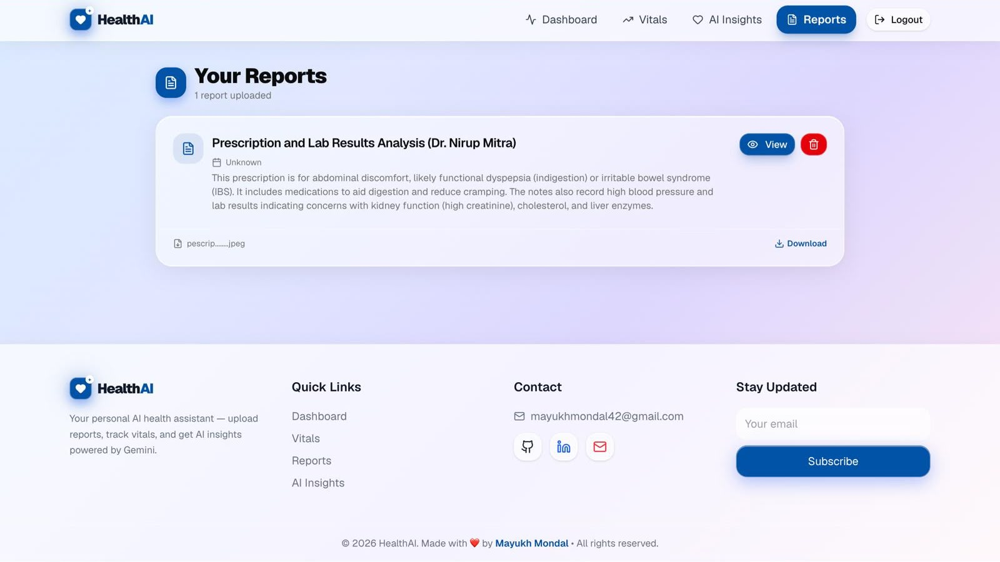

🏥 HealthAI — AI-Powered Medical Report Analysis Platform

 <strong>Transforming Complex Medical Reports into Clear, Actionable Insights using AI.</strong>

 Built with MERN Stack • Google Gemini AI • Cloudinary • JWT Authentication

 🌐 <b>Live Website:</b> https://client-tau-rosy-50.vercel.app/  
 📂 <b>GitHub:</b> https://github.com/mayukhmondal42/healthcare

---

📖 Overview

HealthAI is a full-stack healthcare intelligence platform that helps users understand their medical reports effortlessly. The application leverages *Google Gemini AI* to analyze medical PDFs and images, generate structured summaries, explain technical terminology, and provide patient-friendly insights in multiple languages.

Instead of manually interpreting complex medical documents, users can upload reports and receive instant AI-powered analysis through a secure and intuitive dashboard.

---

✨ Features

🔐 Secure Authentication

- JWT-based authentication system
- Protected routes and private user data
- Secure login and registration flow

🤖 AI-Powered Report Analysis

- Upload medical reports in PDF or image format
- Automated report parsing using Google Gemini AI
- Easy-to-understand summaries and explanations
- Multi-language support for improved accessibility

☁️ Cloud-Based Storage

- Secure report storage with Cloudinary
- Fast file retrieval and management
- Automatic cleanup of deleted records

📊 Personal Health Dashboard

- Centralized report management
- View AI-generated insights anytime
- Track report history and analysis results

🗑️ Report Management

- Upload, view, and delete reports
- Synchronized deletion from MongoDB and Cloudinary
- Maintains database consistency and integrity

---

📸 Application Preview

Authentication

Dashboard

Dashboard With Reports

AI Report Analysis

---

🛠️ Tech Stack

Frontend

- http://React.js / http://Next.js
- Tailwind CSS
- SweetAlert2

Backend

- http://Node.js
- http://Express.js

Database

- MongoDB
- Mongoose ODM

AI & Cloud Services

- Google Gemini API
- Cloudinary

---

🏗️ System Architecture

User Upload
 │
 ▼
Express API
 │
 ├── Cloudinary Storage
 │
 ├── Google Gemini AI
 │
 ▼
MongoDB Database
 │
 ▼
Personal Dashboard

---

🧠 Technical Highlights

High-Performance File Processing

Implemented an in-memory processing pipeline using:

multer.memoryStorage()

This eliminates unnecessary disk operations and enables:

- Faster upload handling
- Reduced server overhead
- Real-time AI processing
- Improved scalability

Production-Ready Error Handling

Retry Mechanism

Custom retry logic for temporary Gemini API failures (503 responses).

Secure File Transmission

Migrated from public file URLs to direct buffer streaming, preventing unauthorized access and reducing security risks.

Robust Validation

Comprehensive frontend and backend validation with meaningful user feedback.

---

🚀 Getting Started

1. Clone the Repository

git clone https://github.com/mayukhmondal42/healthcare.git
cd healthcare

2. Install Dependencies

Backend:

cd server
npm install

Frontend:

cd client
npm install

3. Environment Variables

Create a `.env` file inside the server directory:

PORT=5000
MONGO_URI=your_mongodb_connection_string
CLOUDINARY_CLOUD_NAME=your_cloud_name
CLOUDINARY_API_KEY=your_api_key
CLOUDINARY_API_SECRET=your_api_secret
GEMINI_API_KEY=your_gemini_api_key
JWT_SECRET=your_jwt_secret

4. Start Development Server

Backend:

npm run dev

Frontend:

npm run dev

Live Demo: https://client-tau-rosy-50.vercel.app/

---

🎯 Future Enhancements

- OCR support for handwritten prescriptions
- Health trend tracking and analytics
- Doctor-sharing functionality
- AI-powered medication explanations
- Mobile application support
- Voice-based report summaries

---

👨‍💻 Developer Notes

This project was built to explore the practical application of Generative AI in healthcare workflows while maintaining a secure, scalable, and user-friendly architecture.

Key focus areas:

- AI Integration
- System Security
- Performance Optimization
- Cloud Infrastructure
- User Experience

*Author:* Mayukh Mondal - https://github.com/mayukhmondal42

---

⭐ Support

If you found this project helpful, consider giving it a star on GitHub.

---

 <strong>Built with ❤️ by Mayukh Mondal for the future of digital healthcare.</strong>

---

Ebar 100% thikthak asbe, ar `ayushmanji` er link ar thakbe na. Just paste kore push kore dao:

git add README.md
git commit -m "docs: final README with own links"
git push origin main
